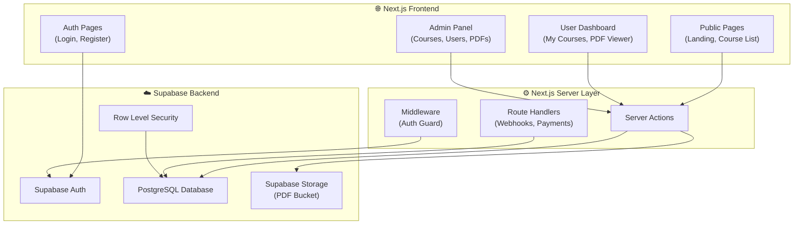
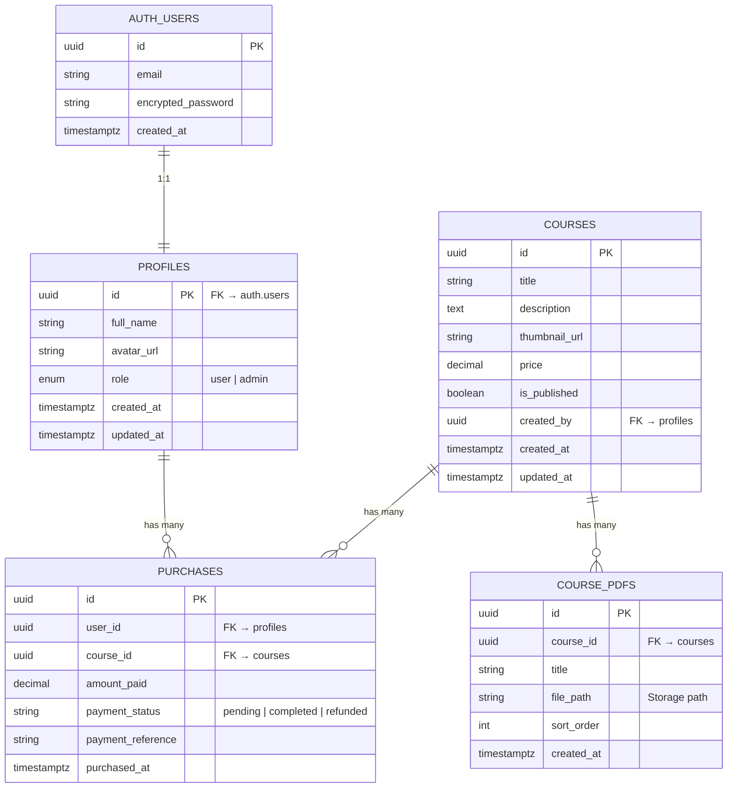
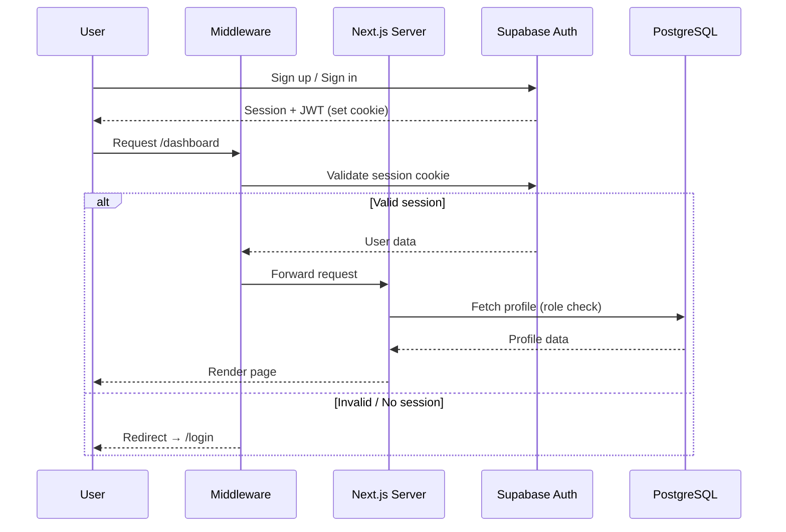
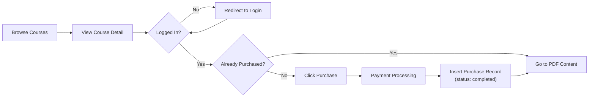
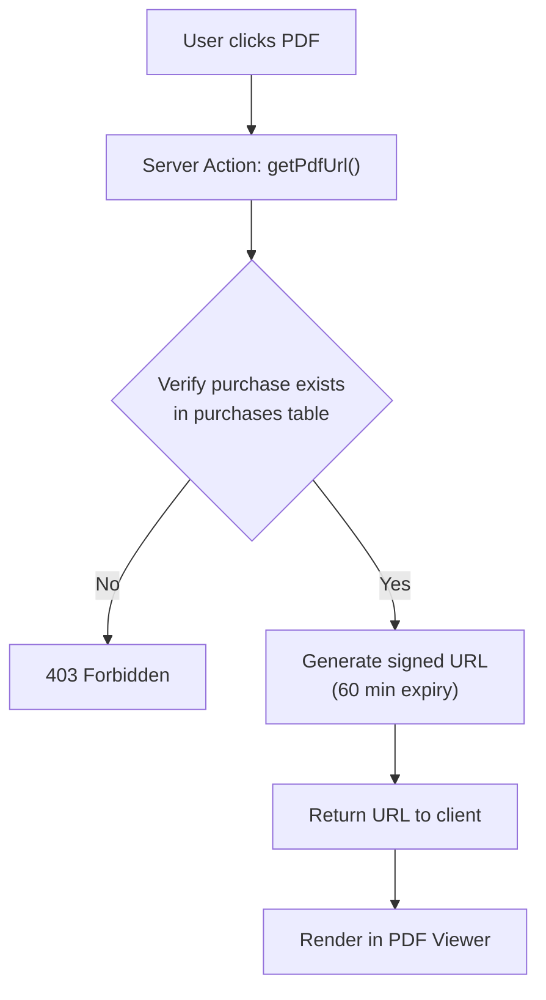
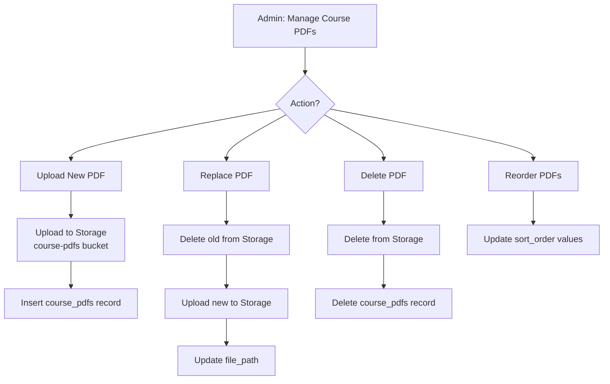

# 📚 LMS Platform — Architecture Document

> **Tech Stack:** Next.js (App Router) + Supabase (Auth, Database, Storage)

---

## 1. System Overview



---

## 2. Database Schema (Supabase PostgreSQL)



### SQL Migration

```sql
-- ============================================
-- 1. PROFILES TABLE
-- ============================================
CREATE TABLE public.profiles (
  id UUID PRIMARY KEY REFERENCES auth.users(id) ON DELETE CASCADE,
  full_name TEXT,
  avatar_url TEXT,
  role TEXT NOT NULL DEFAULT 'user' CHECK (role IN ('user', 'admin')),
  created_at TIMESTAMPTZ NOT NULL DEFAULT now(),
  updated_at TIMESTAMPTZ NOT NULL DEFAULT now()
);

ALTER TABLE public.profiles ENABLE ROW LEVEL SECURITY;

-- Users can read their own profile
CREATE POLICY "Users can view own profile"
  ON public.profiles FOR SELECT
  TO authenticated
  USING (auth.uid() = id);

-- Users can update their own profile
CREATE POLICY "Users can update own profile"
  ON public.profiles FOR UPDATE
  TO authenticated
  USING (auth.uid() = id)
  WITH CHECK (auth.uid() = id);

-- Admins can view all profiles
CREATE POLICY "Admins can view all profiles"
  ON public.profiles FOR SELECT
  TO authenticated
  USING (
    EXISTS (
      SELECT 1 FROM public.profiles WHERE id = auth.uid() AND role = 'admin'
    )
  );

-- Admins can update all profiles
CREATE POLICY "Admins can update all profiles"
  ON public.profiles FOR UPDATE
  TO authenticated
  USING (
    EXISTS (
      SELECT 1 FROM public.profiles WHERE id = auth.uid() AND role = 'admin'
    )
  );

-- ============================================
-- 2. COURSES TABLE
-- ============================================
CREATE TABLE public.courses (
  id UUID PRIMARY KEY DEFAULT gen_random_uuid(),
  title TEXT NOT NULL,
  description TEXT,
  thumbnail_url TEXT,
  price DECIMAL(10,2) NOT NULL DEFAULT 0.00,
  is_published BOOLEAN NOT NULL DEFAULT false,
  created_by UUID REFERENCES public.profiles(id),
  created_at TIMESTAMPTZ NOT NULL DEFAULT now(),
  updated_at TIMESTAMPTZ NOT NULL DEFAULT now()
);

ALTER TABLE public.courses ENABLE ROW LEVEL SECURITY;

-- Anyone can view published courses
CREATE POLICY "Anyone can view published courses"
  ON public.courses FOR SELECT
  USING (is_published = true);

-- Admins can do everything
CREATE POLICY "Admins full access to courses"
  ON public.courses FOR ALL
  TO authenticated
  USING (
    EXISTS (
      SELECT 1 FROM public.profiles WHERE id = auth.uid() AND role = 'admin'
    )
  );

-- ============================================
-- 3. COURSE_PDFS TABLE
-- ============================================
CREATE TABLE public.course_pdfs (
  id UUID PRIMARY KEY DEFAULT gen_random_uuid(),
  course_id UUID NOT NULL REFERENCES public.courses(id) ON DELETE CASCADE,
  title TEXT NOT NULL,
  file_path TEXT NOT NULL,
  sort_order INT NOT NULL DEFAULT 0,
  created_at TIMESTAMPTZ NOT NULL DEFAULT now()
);

ALTER TABLE public.course_pdfs ENABLE ROW LEVEL SECURITY;

-- Users who purchased the course can view PDFs
CREATE POLICY "Purchasers can view course PDFs"
  ON public.course_pdfs FOR SELECT
  TO authenticated
  USING (
    EXISTS (
      SELECT 1 FROM public.purchases
      WHERE purchases.course_id = course_pdfs.course_id
        AND purchases.user_id = auth.uid()
        AND purchases.payment_status = 'completed'
    )
  );

-- Admins can do everything
CREATE POLICY "Admins full access to course_pdfs"
  ON public.course_pdfs FOR ALL
  TO authenticated
  USING (
    EXISTS (
      SELECT 1 FROM public.profiles WHERE id = auth.uid() AND role = 'admin'
    )
  );

-- ============================================
-- 4. PURCHASES TABLE
-- ============================================
CREATE TABLE public.purchases (
  id UUID PRIMARY KEY DEFAULT gen_random_uuid(),
  user_id UUID NOT NULL REFERENCES public.profiles(id) ON DELETE CASCADE,
  course_id UUID NOT NULL REFERENCES public.courses(id) ON DELETE CASCADE,
  amount_paid DECIMAL(10,2) NOT NULL,
  payment_status TEXT NOT NULL DEFAULT 'pending'
    CHECK (payment_status IN ('pending', 'completed', 'refunded')),
  payment_reference TEXT,
  purchased_at TIMESTAMPTZ NOT NULL DEFAULT now(),
  UNIQUE(user_id, course_id)
);

ALTER TABLE public.purchases ENABLE ROW LEVEL SECURITY;

-- Users can view their own purchases
CREATE POLICY "Users can view own purchases"
  ON public.purchases FOR SELECT
  TO authenticated
  USING (auth.uid() = user_id);

-- Admins can view all purchases
CREATE POLICY "Admins full access to purchases"
  ON public.purchases FOR ALL
  TO authenticated
  USING (
    EXISTS (
      SELECT 1 FROM public.profiles WHERE id = auth.uid() AND role = 'admin'
    )
  );

-- ============================================
-- 5. AUTO-CREATE PROFILE ON SIGNUP (Trigger)
-- ============================================
CREATE OR REPLACE FUNCTION public.handle_new_user()
RETURNS TRIGGER AS $$
BEGIN
  INSERT INTO public.profiles (id, full_name, avatar_url)
  VALUES (
    NEW.id,
    NEW.raw_user_meta_data->>'full_name',
    NEW.raw_user_meta_data->>'avatar_url'
  );
  RETURN NEW;
END;
$$ LANGUAGE plpgsql SECURITY DEFINER;

CREATE TRIGGER on_auth_user_created
  AFTER INSERT ON auth.users
  FOR EACH ROW EXECUTE FUNCTION public.handle_new_user();
```

---

## 3. Supabase Storage Configuration

| Bucket | Access | Purpose |
|--------|--------|---------|
| `course-thumbnails` | **Public** | Course cover images |
| `course-pdfs` | **Private** | PDF files (access controlled via signed URLs) |

### Storage Policies for `course-pdfs` bucket

```sql
-- Only admins can upload/update/delete PDFs
CREATE POLICY "Admins can upload PDFs"
  ON storage.objects FOR INSERT
  TO authenticated
  WITH CHECK (
    bucket_id = 'course-pdfs'
    AND EXISTS (
      SELECT 1 FROM public.profiles WHERE id = auth.uid() AND role = 'admin'
    )
  );

CREATE POLICY "Admins can update PDFs"
  ON storage.objects FOR UPDATE
  TO authenticated
  USING (
    bucket_id = 'course-pdfs'
    AND EXISTS (
      SELECT 1 FROM public.profiles WHERE id = auth.uid() AND role = 'admin'
    )
  );

CREATE POLICY "Admins can delete PDFs"
  ON storage.objects FOR DELETE
  TO authenticated
  USING (
    bucket_id = 'course-pdfs'
    AND EXISTS (
      SELECT 1 FROM public.profiles WHERE id = auth.uid() AND role = 'admin'
    )
  );

-- Authenticated users who purchased can download
-- (access enforced via signed URLs generated server-side)
```

> **⚠️ IMPORTANT:** PDF downloads are served via **signed URLs** generated in Server Actions after verifying the user's purchase. The bucket itself stays private — no direct public access.

---

## 4. Next.js Project Structure (App Router)

```
LMS/
├── app/
│   ├── layout.tsx                    # Root layout (html, body, providers)
│   ├── page.tsx                      # Landing / Home page
│   ├── globals.css
│   │
│   ├── (auth)/                       # Auth route group
│   │   ├── login/
│   │   │   └── page.tsx
│   │   ├── register/
│   │   │   └── page.tsx
│   │   └── callback/
│   │       └── route.ts              # Supabase auth callback handler
│   │
│   ├── (public)/                     # Public route group
│   │   ├── courses/
│   │   │   ├── page.tsx              # Browse all courses
│   │   │   └── [courseId]/
│   │   │       └── page.tsx          # Course detail / purchase page
│   │   └── layout.tsx
│   │
│   ├── (dashboard)/                  # Protected user area
│   │   ├── layout.tsx                # Dashboard layout + auth check
│   │   ├── dashboard/
│   │   │   └── page.tsx              # My purchased courses
│   │   └── courses/
│   │       └── [courseId]/
│   │           ├── page.tsx          # Course content (PDF list)
│   │           └── [pdfId]/
│   │               └── page.tsx      # PDF viewer page
│   │
│   ├── (admin)/                      # Admin panel
│   │   ├── layout.tsx                # Admin layout + role check
│   │   └── admin/
│   │       ├── page.tsx              # Admin dashboard / overview
│   │       ├── courses/
│   │       │   ├── page.tsx          # Manage courses list
│   │       │   ├── new/
│   │       │   │   └── page.tsx      # Create new course
│   │       │   └── [courseId]/
│   │       │       ├── page.tsx      # Edit course
│   │       │       └── pdfs/
│   │       │           └── page.tsx  # Manage PDFs for course
│   │       └── users/
│   │           ├── page.tsx          # User management list
│   │           └── [userId]/
│   │               └── page.tsx      # User detail / edit
│   │
│   └── api/                          # Route handlers
│       └── payment/
│           └── webhook/
│               └── route.ts          # Payment gateway webhook
│
├── components/
│   ├── ui/                           # Reusable UI components
│   │   ├── button.tsx
│   │   ├── card.tsx
│   │   ├── input.tsx
│   │   ├── modal.tsx
│   │   └── ...
│   ├── layout/
│   │   ├── navbar.tsx
│   │   ├── sidebar.tsx
│   │   ├── footer.tsx
│   │   └── admin-sidebar.tsx
│   ├── courses/
│   │   ├── course-card.tsx
│   │   ├── course-grid.tsx
│   │   ├── course-detail.tsx
│   │   └── purchase-button.tsx
│   ├── dashboard/
│   │   ├── purchased-courses.tsx
│   │   └── stats-cards.tsx
│   ├── admin/
│   │   ├── course-form.tsx
│   │   ├── pdf-upload.tsx
│   │   ├── pdf-list.tsx
│   │   └── user-table.tsx
│   └── pdf/
│       └── pdf-viewer.tsx
│
├── lib/
│   ├── supabase/
│   │   ├── client.ts                 # Browser client
│   │   ├── server.ts                 # Server client (cookies)
│   │   ├── admin.ts                  # Service role client (admin ops)
│   │   └── middleware.ts             # Middleware client
│   ├── actions/
│   │   ├── auth.ts                   # Login, register, logout
│   │   ├── courses.ts                # CRUD for courses
│   │   ├── pdfs.ts                   # Upload, delete, reorder PDFs
│   │   ├── purchases.ts             # Purchase flow, verify
│   │   └── users.ts                  # Admin user management
│   ├── types/
│   │   └── database.ts              # Generated Supabase types
│   └── utils.ts                     # Helpers (formatPrice, etc.)
│
├── middleware.ts                     # Route protection middleware
├── next.config.ts
├── tailwind.config.ts
├── tsconfig.json
├── package.json
└── .env.local                        # Supabase keys
```

---

## 5. Authentication & Authorization Flow



### Middleware (`middleware.ts`)

```typescript
import { createServerClient } from '@supabase/ssr'
import { NextResponse, type NextRequest } from 'next/server'

export async function middleware(request: NextRequest) {
  let response = NextResponse.next({ request })

  const supabase = createServerClient(
    process.env.NEXT_PUBLIC_SUPABASE_URL!,
    process.env.NEXT_PUBLIC_SUPABASE_ANON_KEY!,
    {
      cookies: {
        getAll: () => request.cookies.getAll(),
        setAll: (cookiesToSet) => {
          cookiesToSet.forEach(({ name, value, options }) => {
            request.cookies.set(name, value)
            response.cookies.set(name, value, options)
          })
        },
      },
    }
  )

  const { data: { user } } = await supabase.auth.getUser()

  // Protect dashboard routes
  if (request.nextUrl.pathname.startsWith('/dashboard') && !user) {
    return NextResponse.redirect(new URL('/login', request.url))
  }

  // Protect admin routes
  if (request.nextUrl.pathname.startsWith('/admin')) {
    if (!user) {
      return NextResponse.redirect(new URL('/login', request.url))
    }
    const { data: profile } = await supabase
      .from('profiles')
      .select('role')
      .eq('id', user.id)
      .single()

    if (profile?.role !== 'admin') {
      return NextResponse.redirect(new URL('/dashboard', request.url))
    }
  }

  return response
}

export const config = {
  matcher: ['/dashboard/:path*', '/admin/:path*'],
}
```

---

## 6. Core User Flows

### 6a. Course Purchase Flow



### 6b. PDF Access Flow (Signed URLs)



### 6c. Admin PDF Management Flow



---

## 7. Key Server Actions

| Action | File | Access | Purpose |
|--------|------|--------|---------|
| `signUp` | `actions/auth.ts` | Public | Register new user |
| `signIn` | `actions/auth.ts` | Public | Email/password login |
| `signOut` | `actions/auth.ts` | Auth | Logout, clear session |
| `getCourses` | `actions/courses.ts` | Public | List published courses |
| `getCourse` | `actions/courses.ts` | Public | Single course detail |
| `createCourse` | `actions/courses.ts` | Admin | Create new course |
| `updateCourse` | `actions/courses.ts` | Admin | Edit course details |
| `deleteCourse` | `actions/courses.ts` | Admin | Remove course + PDFs |
| `uploadPdf` | `actions/pdfs.ts` | Admin | Upload PDF to storage |
| `deletePdf` | `actions/pdfs.ts` | Admin | Remove PDF |
| `reorderPdfs` | `actions/pdfs.ts` | Admin | Change PDF sort order |
| `getSignedPdfUrl` | `actions/pdfs.ts` | Purchaser | Generate download URL |
| `purchaseCourse` | `actions/purchases.ts` | Auth | Create purchase record |
| `getMyPurchases` | `actions/purchases.ts` | Auth | User's purchased courses |
| `getAllUsers` | `actions/users.ts` | Admin | List all users |
| `updateUserRole` | `actions/users.ts` | Admin | Change user role |

---

## 8. Environment Variables

```env
# .env.local
NEXT_PUBLIC_SUPABASE_URL=https://your-project.supabase.co
NEXT_PUBLIC_SUPABASE_ANON_KEY=eyJ...
SUPABASE_SERVICE_ROLE_KEY=eyJ...           # Server-only, never exposed
NEXT_PUBLIC_APP_URL=http://localhost:3000
```

> **🚨 CAUTION:** The `SUPABASE_SERVICE_ROLE_KEY` must **never** be prefixed with `NEXT_PUBLIC_`. It bypasses RLS and should only be used in Server Actions and Route Handlers.

---

## 9. Key Dependencies

| Package | Purpose |
|---------|---------|
| `next` | React framework (App Router) |
| `@supabase/supabase-js` | Supabase client SDK |
| `@supabase/ssr` | Server-side Supabase auth (cookie-based) |
| `tailwindcss` | Utility-first CSS |
| `react-pdf` or `@react-pdf-viewer/core` | In-browser PDF rendering |
| `lucide-react` | Icons |
| `sonner` | Toast notifications |
| `zod` | Form validation |

---

## 10. Page Map

| Route | Access | Description |
|-------|--------|-------------|
| `/` | Public | Landing page with featured courses |
| `/login` | Public | Sign in form |
| `/register` | Public | Sign up form |
| `/courses` | Public | Browse all published courses |
| `/courses/[courseId]` | Public | Course detail + purchase CTA |
| `/dashboard` | Auth | User's purchased courses grid |
| `/dashboard/courses/[courseId]` | Purchaser | PDF list for a purchased course |
| `/dashboard/courses/[courseId]/[pdfId]` | Purchaser | PDF viewer |
| `/admin` | Admin | Admin overview (stats) |
| `/admin/courses` | Admin | Manage all courses |
| `/admin/courses/new` | Admin | Create a new course |
| `/admin/courses/[courseId]` | Admin | Edit a course |
| `/admin/courses/[courseId]/pdfs` | Admin | Upload/manage PDFs |
| `/admin/users` | Admin | View/manage all users |
| `/admin/users/[userId]` | Admin | Edit user details/role |

---

## 11. Security Summary

| Layer | Mechanism |
|-------|-----------|
| **Authentication** | Supabase Auth (email/password), JWT in HTTP-only cookies via `@supabase/ssr` |
| **Route Protection** | Next.js Middleware — redirects unauthenticated users |
| **Role Authorization** | Middleware + Server Actions check `profiles.role` before admin ops |
| **Data Access** | Row Level Security on every table — even if app logic fails, DB blocks unauthorized access |
| **PDF Protection** | Private storage bucket + time-limited signed URLs generated server-side after purchase verification |
| **Input Validation** | Zod schemas in Server Actions before any DB write |
| **CSRF** | Server Actions use POST with origin verification by default in Next.js |
